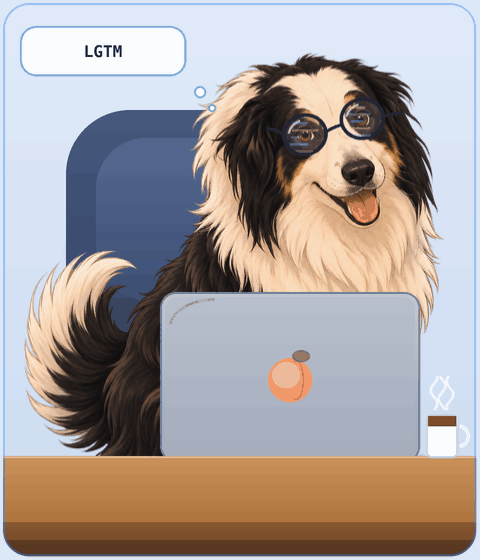

<p align="center">
  
</p>

<p align="center">
  <a href="https://www.linkedin.com/in/adilevy07/"></a>
  <a href="https://studypilot.dev"></a>
  <a href="https://chatter-2.com"></a>
</p>

---

```python
class Adi:
    school   = "Cal Poly Pomona"
    major    = "Computer Science"
    minor    = "Mathematics"
    lab      = "CALSys Lab (Cyber Threat Intelligence)"
    obsessed = ["networking", "compilers & interpreters", "making hard things feel easy"]
    fuel     = "curiosity (and snacks)"

    def currently(self):
        return {
            "building":  "Pixelate, a UI-first programming language with python core",
            "operating":   "a self-hosted video streaming platform",
        }
```

## 🔭 Spotlight: Pixelate *(private, for now)*

Today, spinning up a simple native window with a button usually means drowning in boilerplate. **Pixelate (`.pxl`)** is my attempt at a domain-specific language for 2D graphics and desktop UIs that reads closer to how you'd describe a layout out loud:

```text
window "Hello" {
    button "Click me" -> say("Hi, Adi")
}
```

I recently restarted the language from scratch in **Python** to build a cleaner, more robust lexer, parser, and runtime from the ground up, wired into a native **C++ Win32** rendering engine for graphics (plus a custom VS Code extension). Opening the repo once the new runtime settles.

## 🛠️ Things I've built

<table>
  <tr>
    <td width="50%" valign="top">
      <h3>📚 <a href="https://studypilot.dev">StudyPilot</a></h3>
      An AI study assistant that adapts to how you learn. Engineered the database architecture, real-time transcription pipeline, and server-side personalization logic.
      <br /><br />
      <sub><code>Flask</code> · <code>Supabase</code> · <code>JavaScript</code> · <code>Anthropic API</code> · <code>AssemblyAI</code> · <i>private</i></sub>
    </td>
    <td width="50%" valign="top">
      <h3>💬 <a href="https://chatter-2.com">Chatter</a></h3>
      Real-time messaging with a desktop app and a web client. Log in, add contacts, DM people, and spin up group chats over raw Python sockets, threading, and a custom delivery protocol.
      <br /><br />
      <sub><code>Python</code> · <code>Sockets</code> · <code>Threading</code> · <code>JavaScript</code> · <a href="https://github.com/adilevy1011/Chatter_2.0">repo</a></sub>
    </td>
  </tr>
  <tr>
    <td width="50%" valign="top">
      <h3>📺 <a href="https://github.com/adilevy1011/streaming">ADLV Streaming Server</a></h3>
      A self-hosted video streaming platform for sharing media privately—complete with cloud block storage and a MobileNet computer vision pipeline for automatic end-credit detection.
      <br /><br />
      <sub><code>FastAPI</code> · <code>Nginx</code> · <code>Supabase</code> · <code>Computer Vision</code> · <a href="https://github.com/adilevy1011/streaming">repo</a></sub>
    </td>
    <td width="50%" valign="top">
      <h3>🎮 <a href="https://github.com/adilevy1011/java-game-engine">Java Game Engine Prototype</a></h3>
      An object-oriented 2D game framework with a menu system and a combat prototype. Proof that I can't resist building the engine before the game.
      <br /><br />
      <sub><code>Java</code> · <code>OOP</code> · <a href="https://github.com/adilevy1011/java-game-engine">repo</a></sub>
    </td>
  </tr>
</table>

## 🧰 Toolbox

Not a resume. Just what's on my desk most days.

<p>
  
  
  
  
  
  
  
  
  
  
  
  
  
</p>

## 🐕 Code review

<p align="center">
  
  <br />
  <sub><i>Peach, senior reviewer. Approves every push😉</i></sub>
</p>

## 📊 The numbers (take with salt)

<p align="center">
  
</p>

---
